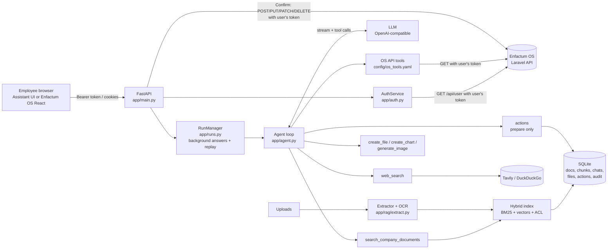

# Architecture

## Components



## Knowledge routing

```text
Question
  ├─ General knowledge          → LLM answers directly (no tool round-trip)
  ├─ Public / current info      → web_search → cited web results
  └─ Private Enfactum info
        ├─ policies / documents → search_company_documents → permission-filtered chunks
        └─ live business data   → Enfactum OS tool(s) → OS enforces the user's access
```

Routing is done by the LLM through native tool calling, guided by the system prompt (`app/prompts.py`). Users can override it with the mode selector:

| Mode | Behaviour |
|---|---|
| Auto | Model chooses; can call several tools in parallel |
| General | No tools |
| Web | Web search runs immediately (no model round-trip first), then the model answers |
| Company | Document search runs immediately; OS tools stay available |

## Request flow (`POST /api/chat`)

```text
Browser ── POST /api/chat (SSE) ──► current_user()
                                      └─ AuthService: demo | laravel (/api/user) | jwt  → UserContext (cached 60s)
                                         └─ employees only (user_type), PERM_CHAT
                                   ► RateLimiter
                                   ► edit/regenerate? delete that user message and everything after it
                                   ► RunManager.start()  ── asyncio task, independent of the HTTP connection
                                      Agent.run()
                                      1. tools = registry.for_user(user, mode)     # unpermitted tools never offered
                                      2. messages = system prompt + last N turns + attachments + question
                                      3. loop (≤ MAX_TOOL_ROUNDS), checking the stop flag between chunks:
                                           stream LLM ──► tokens appended to the run's event log
                                           tool calls? ─► re-check allowed set, validate args,
                                                          run in parallel (TOOL_TIMEOUT_SECONDS each),
                                                          wrap results as untrusted data, audit log,
                                                          files/actions → artifact events
                                      4. keep only sources actually cited [n]; persist answer + artifacts + timing
                                   ◄ the HTTP response just subscribes to the run's event log
Browser ◄── events: run · conversation · user_message · status · token · artifact · usage · sources · done · run_end
```

**Background runs.** The browser only *subscribes*. Closing the tab, switching chats or refreshing drops the subscription, not the answer. On return the client calls `GET /api/conversations/{id}` (which reports `active_run`) and re-attaches with `GET /api/runs/{id}/events?from=0`, replaying everything generated so far. `GET /api/runs` drives the sidebar: running chats get a spinner, finished-but-unseen chats a blue tick. Opening the chat marks it seen. Stopping is cooperative (`POST /api/runs/{id}/cancel`), and the partial answer is saved. Runs live in process memory (one worker per container); finished runs are kept for up to 6 h.

**Actions.** An action tool call stores a `pending_actions` row and emits an `action` artifact (confirmation card). `POST /api/actions/{id}/confirm` executes it outside the agent loop (see `docs/SECURITY.md`), then records the result in the conversation so later turns know about it.

**Files.** `create_file` / `create_chart` / `generate_image` build bytes in a worker thread, store them as `attachments` (kind `generated`) owned by the employee, and emit `file` / `image` artifacts with `/api/files/{id}` URLs.

## Accuracy design

- **Grounding rules:** Enfactum and current-events claims must come from tool results; empty or denied results must be stated rather than guessed.
- **Citations:** every tool result is numbered through a shared `Citations` registry, and the model cites `[n]`. The UI shows only sources that were actually cited.
- **Hybrid retrieval:** BM25 (exact terms, names, codes) and dense vectors (semantics) are fused with Reciprocal Rank Fusion. Chunks keep their section heading, so retrieved fragments stay self-describing.
- **Web depth:** Tavily returns extracted page content. With DuckDuckGo, the top `WEB_FETCH_PAGES` pages are fetched in full (2.5 s budget each).
- **OCR:** scanned PDF pages (no text layer) and images are transcribed by a vision model or Tesseract, so their text is searchable and citable.
- **Clean history:** old citation markers are stripped from history so stale numbers can't be re-cited.

## Performance design

Target: first words in about 1 s and a complete answer in under 5 s with a fast model.

- Token streaming from the first byte, with status events while tools run.
- General questions skip tools entirely (single LLM call).
- Parallel tool calls (`parallel_tool_calls`), executed with `asyncio.gather`.
- Forced modes pre-run retrieval, saving a full model round-trip.
- Fail-fast budgets: LLM 30 s between chunks with 1 retry; tools 12 s; web 6 s plus 2.5 s per page fetch; query embeddings 4 s with no retry, then keyword-search fallback (previously one slow call could block for 90 s).
- Tavily `basic` depth (about 1 s) instead of `advanced`.
- Optional `LLM_REASONING_EFFORT` for thinking models.
- Shared `httpx` connection pool, LRU cache for query embeddings, 60 s identity cache.
- In-memory index (NumPy matrix + inverted index): millisecond retrieval up to roughly 100k chunks.
- **Telemetry:** every answer logs and stores `total / first_token / llm / tools / rounds`. The UI shows the total next to the ✓, with the breakdown on hover.

## Storage

SQLite (`DATA_DIR/assistant.db`, WAL mode):

- `documents` / `chunks`: knowledge base with per-document `visibility` JSON, float32 embeddings, extracted text and the original file (`DATA_DIR/documents/`) for preview/download.
- `conversations` / `messages`: per-user history, always queried with `user_id`. Message `meta` holds mode, tools, timing, context usage and artifacts.
- `attachments`: uploaded files and generated files (`DATA_DIR/attachments/`), private to the owner.
- `feedback`: 👍/👎 per message. `pending_actions`: prepared/confirmed actions and results.
- `audit_log`: tool calls (name and arguments, not results), denied tool attempts, document uploads/deletes, action lifecycle.

## Scaling path

The current design targets one container with one async worker, which is enough for hundreds of concurrent employees. For more:

1. Move chunks/embeddings to PostgreSQL + pgvector (Enfactum already runs PostgreSQL) or Qdrant, and replace `DocumentIndex` (the interface is a single `search(query, user, k)`).
2. Move the rate limiter and identity cache to Redis.
3. Move run event logs to Redis Streams (the `RunManager` interface is `start / subscribe / cancel / for_user`), or use sticky sessions.
4. Then run several replicas behind a load balancer.
